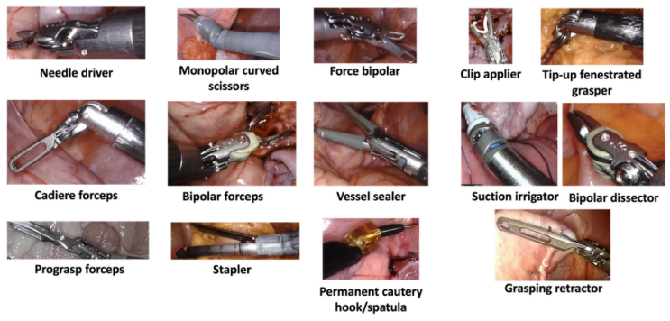
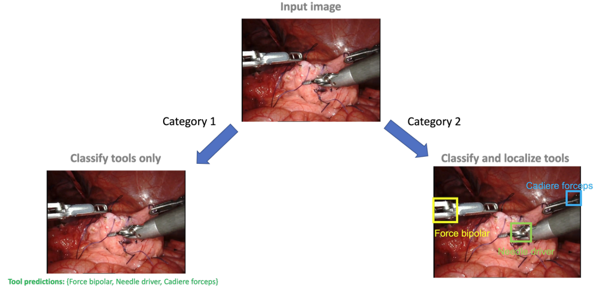

# SurgToolLoc

<div align="center">
    <a href="https://github.com/openmedlab/"></a>
</div>
<p style="text-align:center;font-size:10px;"><em></em></p>

## Dataset Information

SurgToolLoc provides 24,695 endoscopic video clips, approximately 30 seconds each, for weakly supervised surgical tool classification and localization. The dataset covers 14 instrument types. Training labels are automatically harvested tool-presence labels, which may be noisy; they are not dense ground-truth bounding-box annotations. The MICCAI 2022 challenge evaluates models on a hidden test set of 93 clips.

Learning from automatically recorded instrument presence can reduce the effort required to annotate surgical video. The dataset supports instrument recognition, localization and research into surgical video understanding.

## Dataset Meta Information

| Dimensions | Modality  | Task Type                 | Anatomical Area  | Number of Categories | Data Volume | File Format |
|------------|-----------|---------------------------|------------------|----------------------|-------------|-------------|
| 2D         | Endoscopy | Classification, Detection | Abdominal Cavity | 14                   | 24695       | .mp4        |

### Resolution Details

| Dataset Statistics | size       |
|--------------------|------------|
| min                | 1280 x 720 |
| median             | 1280 x 720 |
| max                | 1280 x 720 |

## Label Information Statistics

| Instrument Type                | Case Count | Coverage |
|--------------------------------|------------|----------|
| Cadiere Forceps                | 17440      | 70.6%    |
| Needle Driver                  | 10142      | 41.1%    |
| Force Bipolar                  | 1698       | 6.9%     |
| Monopolar Curved Scissors      | 11924      | 48.3%    |
| Grasping Retractor             | 4413       | 17.9%    |
| Bipolar Forceps                | 13163      | 53.3%    |
| Clip Applier                   | 576        | 2.3%     |
| Vessel Sealer                  | 1026       | 4.2%     |
| ProGrasp Forceps               | 2992       | 12.1%    |
| Tip-Up Fenestrated Grasper     | 181        | 0.7%     |
| Permanent Cautery Hook/Spatula | 866        | 3.5%     |
| Suction Irrigator              | 17         | 0.07%    |
| Stapler                        | 131        | 0.5%     |
| Bipolar Dissector              | 17         | 0.07%    |

## Visualization

<div align="center">
    <a href="https://github.com/openmedlab/"></a>
</div>
<p style="text-align:center;font-size:10px;"><em>The 14 surgical instrument types.</em></p>

<div align="center">
    <a href="https://github.com/openmedlab/"></a>
</div>
<p style="text-align:center;font-size:10px;"><em>Classification and localization task schematic.</em></p>

## File Structure

``` 
training_data/  
└── video_clips/  
        ├── clip_000000.mp4  
        ├── clip_000001.mp4  
        ├── clip_000002.mp4  
        ├── clip_000003.mp4  
        └── clip_000004.mp4 
        └── ...
└── labels.csv
```

## Authors and Institutions

The source introduction lists the first three authors and the final author.

Aneeq Zia  (Intuitive Surgical, Inc.)

Kiran Bhattacharyya (Intuitive Surgical, Inc.)

Xi Liu  (Intuitive Surgical, Inc.)

Anthony Jarc  (Intuitive Surgical, Inc.)

## Source Information

Official Website: https://surgtoolloc23.grand-challenge.org/

Download Link: https://surgtoolloc23.grand-challenge.org/

Article Address: https://arxiv.org/abs/2305.07152v1

Publication Date: 2023-05

## Citation

``` 
@article{zia2023surgical,
  title={Surgical tool classification and localization: results and methods from the MICCAI 2022 SurgToolLoc challenge},
  author={Zia, Aneeq and Bhattacharyya, Kiran and Liu, Xi and Berniker, Max and Wang, Ziheng and Nespolo, Rogerio and Kondo, Satoshi and Kasai, Satoshi and Hirasawa, Kousuke and Liu, Bo and others},
  journal={arXiv preprint arXiv:2305.07152},
  year={2023}
}
```

Original introduction article is [here](https://zhuanlan.zhihu.com/p/701669086).
