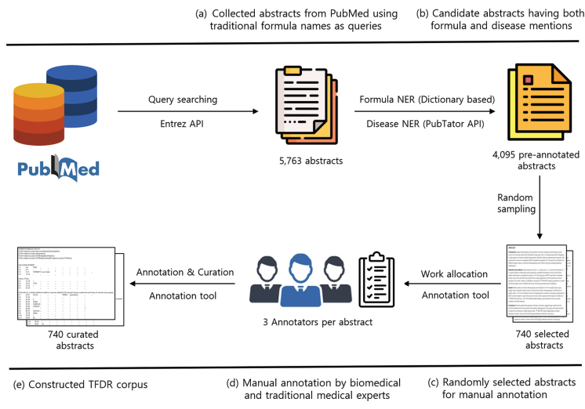
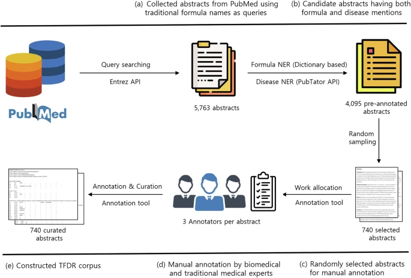
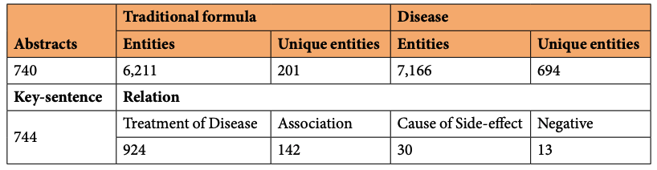
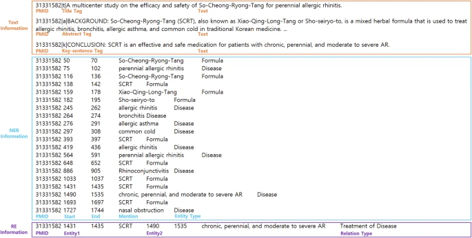

# TFDR

<div align="center">
    <a href="https://github.com/openmedlab/"></a>
</div>
<p style="text-align:center;font-size:10px;"><em></em></p>

## Dataset Information

TFDR (Traditional Formula-Disease Relationships) is an annotated English biomedical corpus for named entity recognition, key-sentence recognition, and relation extraction. Researchers manually annotated 740 PubMed abstracts, identifying 6,211 traditional-formula mentions, 7,166 disease mentions, and 1,109 relationships in 744 key sentences.

Key sentences summarize results or conclusions involving traditional formula and disease entities. The corpus provides four relation categories and baseline experiments with Transformer encoders. Mention counts, relation counts, and document counts are distinct units; 6,211 is the number of formula mentions rather than the number of abstracts.

## Dataset Meta Information

| Task Type                                          | Language | Train                      | Val | Test | File Format | Size                             |
|----------------------------------------------------|----------|----------------------------|-----|------|-------------|----------------------------------|
| NER; Key-sentence Recognition; Relation Extraction | English  | 740 abstracts (collection) | -   | -    | .tsv        | Not reported in the introduction |

## Dataset Information Statistics

| Item                         | Count |
|------------------------------|-------|
| PubMed abstracts             | 740   |
| Traditional-formula mentions | 6211  |
| Disease mentions             | 7166  |
| Key sentences                | 744   |
| Annotated relationships      | 1109  |

| Relation                 | Count | Percentage |
|--------------------------|-------|------------|
| Disease treatment        | 924   | 83.3%      |
| Association              | 142   | 12.8%      |
| Cause of adverse effects | 30    | 2.7%       |
| Negation                 | 13    | 1.2%       |

<div align="center">
    <a href="https://github.com/openmedlab/"></a>
</div>
<p style="text-align:center;font-size:10px;"><em>Corpus construction workflow.</em></p>

<div align="center">
    <a href="https://github.com/openmedlab/"></a>
</div>
<p style="text-align:center;font-size:10px;"><em>Overall TFDR corpus statistics.</em></p>

## Dataset Example

The annotation example identifies traditional formula mentions, disease mentions, key sentences, and the relationship between the entities.

<div align="center">
    <a href="https://github.com/openmedlab/"></a>
</div>
<p style="text-align:center;font-size:10px;"><em>TFDR annotation example (PMID: 31331528).</em></p>

## File Structure

```
data
├── Codes
├── Corpus
│   ├── RawData
│   ├── ProcData
```

## Authors and Institutions

Sangjun Yea (Korea Institute of Oriental Medicine)

Ho Jang, Soyoung Kim, Sanghun Lee (Korea Institute of Oriental Medicine; University of Science and Technology)

Jaeuk U. Kim (University of Science and Technology; Korea Institute of Oriental Medicine)

## Source Information

Official Website: https://github.com/KIOM-AIDoc/TFDR

Download Link: https://figshare.com/articles/dataset/TFDR_corpus_annotated_corpus_for_traditional_formula-disease_relationships_in_biomedical_articles/27073672

Article Address: https://www.nature.com/articles/s41597-025-04377-2

Publication Date: 2025-01

## Citation

```
@article{yea2025annotated,
  title={Annotated corpus for traditional formula-disease relationships in biomedical articles},
  author={Yea, Sangjun and Jang, Ho and Kim, Soyoung and Lee, Sanghun and Kim, Jaeuk U},
  journal={Scientific Data},
  volume={12},
  number={1},
  pages={26},
  year={2025},
  publisher={Nature Publishing Group UK London}
}
```

Original introduction article is [here](https://zhuanlan.zhihu.com/p/17948913662).
